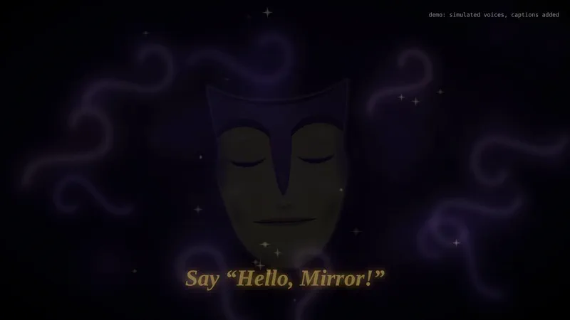
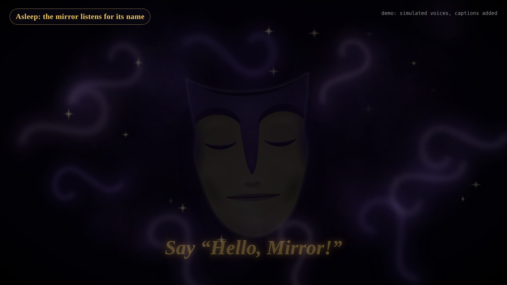
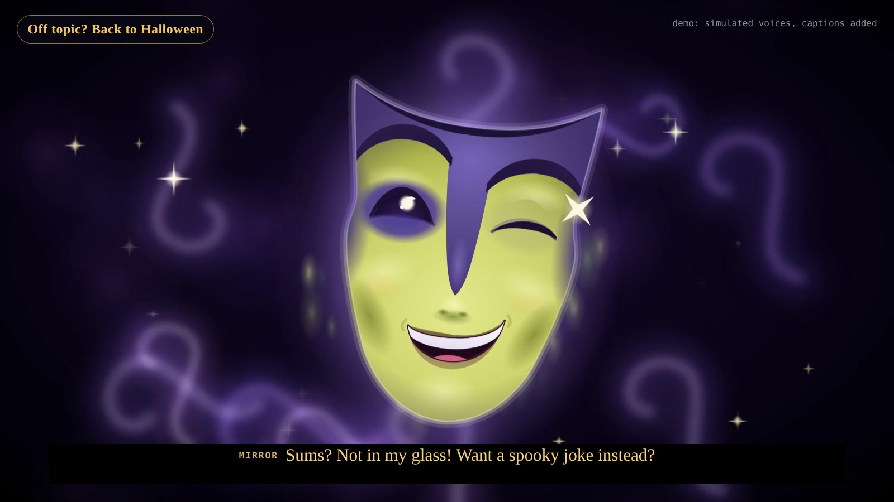
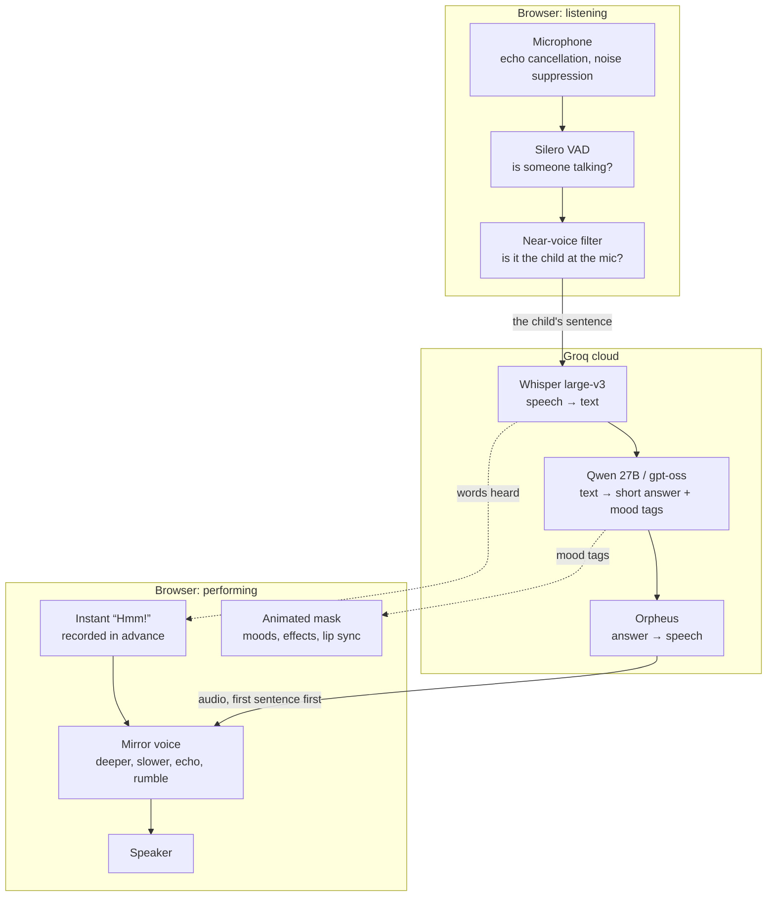
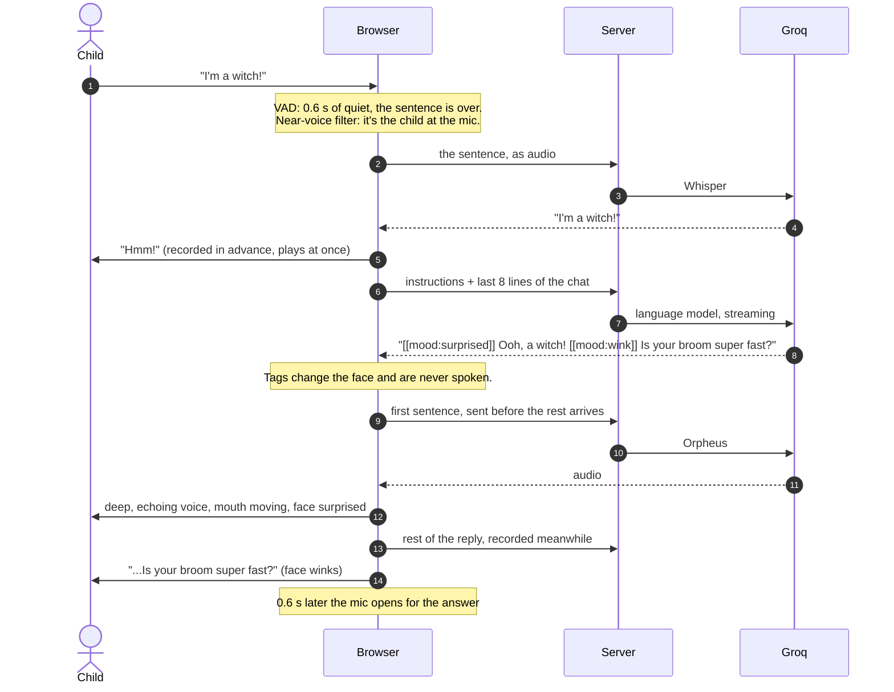

# Halloween Magic Mirror

A talking magic mirror for a family Halloween party. A laptop hidden behind a two-way mirror shows an animated mask. Children talk to it, and it talks back out loud, in character as the Evil Queen's mirror from *Snow White*, now a cheeky friend who hands out the treats.

<p align="center">
  
</p>
<p align="center"><sub>One visit, recorded from the running app (about a minute). The children's voices, the AI and the cloud voice are simulated with scripted lines, so the recording can be reproduced exactly. Captions show what is said, because the video has no sound. <a href="docs/demo.mp4">Full-quality HD MP4 (1600×900)</a> · <a href="docs/demo.gif">18 s GIF</a></sub></p>

> *"Mirror, mirror, on the wall, who is the fairest of them all?"*

The goal was a character that feels alive. Like Disney's *Turtle Talk with Crush*, it should answer quickly, stay in character, and never leave a child standing in silence. Behind the glass sits a real-time voice pipeline: speech detection, speech-to-text, a language model and text-to-speech. Around it is the engineering needed to make it work at a noisy party with small children.

**Contents:** [What it does](#what-it-does) · [How it works](#how-it-works) · [The building blocks](#the-building-blocks) · [Speed](#speed-where-the-time-goes) · [Reliability](#reliability-it-never-gets-stuck) · [Safety and privacy](#safety-and-privacy) · [Testing](#testing) · [Tech stack](#tech-stack) · [Running it](#running-it) · [Project structure](#project-structure)

---

## What it does

<p align="center">
  
  
</p>

- **Wakes when a child says "Hello, Mirror!"** The words glow in gold while it sleeps. It greets every child with the classic line, and goes back to sleep (forgetting that child) after 30 seconds of quiet.
- **Holds a real conversation.** It crowns the fairest, praises costumes, answers Halloween questions, tells jokes and riddles, and hands out treats.
- **Understands English, Tagalog and Taglish**, and always answers in English.
- **Stays on theme.** Replies are about 15 words of everyday language a four-year-old understands. Off-topic questions ("What's nine times eight?") get a cheeky "Not in my glass!" and a Halloween question back.
- **Reacts instantly.** A quick "Hmm!" or "Aha!" plays the moment it starts thinking, and the first sentence of the answer is spoken while the rest is still being made.
- **Sounds like a magic mirror.** A deep, slow, echoing voice, with a mask whose mouth, moods and effects follow what it says.
- **Copes with a loud party.** It answers the child talking into the mic and ignores the crowd behind them.
- **Looks after the children.** It never comments on looks, never asks for personal details, and flags a lost or upset child to the grown-ups.

## How it works

The laptop runs two programs. **Chrome** shows the face, listens to the microphone and plays the sound. A small **Node.js server** holds the API key and talks to **Groq**, a cloud provider that runs AI models on its own fast chips. Hearing, thinking and talking happen at Groq; everything a child sees and hears is produced on the laptop.



### One question, step by step



## The building blocks

### 1. Noticing that a child is talking: Voice Activity Detection

**What it is.** A VAD answers one question many times a second: *is someone speaking right now?* It knows no words. It tells speech apart from music, footsteps and silence, so the mirror knows when a child has started and finished a sentence.

**What we used.** [Silero VAD](https://github.com/snakers4/silero-vad) v6, a 2.3 MB neural network, runs inside Chrome through [`@ricky0123/vad-web`](https://github.com/ricky0123/vad) and ONNX Runtime Web. Nothing leaves the laptop at this stage.

**How it's tuned.**
- Every 32 ms of audio gets a speech score from 0 to 1. Above 0.5, speech has started; below 0.35 for 600 ms, it has ended.
- 300 ms before the start is kept, so the first word isn't clipped, and blips under 250 ms are ignored.
- If the words sound unfinished ("I'm a…", "um", "and"), the mirror waits up to 2 s more for slow talkers.

### 2. Hearing the right child at a loud party

A VAD hears *all* speech, including the crowd. Noise suppression can't help either, because chatter is speech too. What sets the child apart is loudness: they talk straight into the mic, so they are far louder than the room.

- **Mic settings.** Echo cancellation (removes the mirror's own voice) and noise suppression are on. Automatic gain is deliberately **off**: it turns the room up between words, which would make a close child and a loud crowd look alike.
- **Near-voice filter** (`src/nearGate.ts`). The room's level is measured continuously, as the 20th percentile of the last 15 s. A sentence is answered only if its loud parts (75th percentile) are at least **12 dB** above that. Crowd chatter measured about 5.5 dB.
- **Ending by loudness** (`src/closeTalk.ts`). In a loud room the VAD can keep hearing chatter as "still talking", so the sentence would never end. The mirror also ends it 0.6 s after the child's own voice drops back to the room's level. It drops stretches of chatter alone after 2 s, so they can't swallow the start of a child's sentence, and no sentence runs past 12 s.

### 3. Turning speech into words: Whisper

**Speech-to-text (STT)** turns recorded speech into written words. The mirror uses OpenAI's **Whisper large-v3**, run by Groq in a fraction of a second, with large-v3-turbo as a backup.

- **A hint for party words.** Whisper gets a hint of party words and Taglish phrases ("trick or treat", "salamin, salamin", "kendi", "aswang"), so it spells them right.
- **Junk filtering.** Whisper sometimes invents text from noise. Segments with low confidence, repetitive output, or text that just echoes the hint are dropped.
- **English and Tagalog only.** If Whisper decides a short, noisy clip is another language (Malay, Welsh…), the clip is transcribed again as English and as Tagalog, side by side, and the more confident result wins.

### 4. Deciding what to say: the language model

A **large language model (LLM)** writes text by predicting the next word. Given instructions, it plays a character. The mirror uses **Qwen 27B** first, with OpenAI's open **gpt-oss 120B and 20B** as backups, all at Groq, with long "reasoning" switched off so answers start fast.

- **The instructions** (`src/prompt.ts`, about 3,950 characters, sent with every request) define the character and the reply rules:
  - short answers in everyday words;
  - what it talks about, and how to turn everything else back;
  - the treat rule and the safety rules;
  - four example exchanges.
- **Memory** is the last 8 lines of the current child's chat, held only in the page.
- **Streaming.** The answer streams back word by word, capped at 80 tokens, so speaking can start before it is finished.
- **Stage directions.** The model also writes hidden tags such as `[[mood:wink]]`, `[[effect:sparkle]]` and `[[alert]]`, which drive the face and the operator alert and are never spoken.
- **A safety net** (`src/conversation.ts`) cuts every answer at the last whole sentence within 20 words and removes anything not in English letters. If nothing sayable is left, the mirror says "Oops! A smudge on my glass! Can you ask me again?".

### 5. Saying it: Orpheus text-to-speech

**Text-to-speech (TTS)** turns words into speech. The mirror uses **Orpheus** (Canopy Labs), run by Groq. Orpheus is itself a small language model that writes sound instead of words. That's why it can act (a `[cheerful]` or `[playful]` direction changes its delivery), and also why it occasionally loops.

- **The deepest voice.** The server measures the pitch of each male voice once and uses the deepest.
- **The first sentence goes alone, at once.** The rest of the reply is recorded *at the same time*, as one flowing take (up to Orpheus's 200-character limit). Takes play in order with a natural breath between them, even when a later take finishes first.
- **Tone directions** are added only where the face's mood changes, because each one makes the voice more "acted".
- **Loop detection.** A take far longer than its words could need is a loop: it is requested again without the direction, and never played.
- **Recordings are kept on disk** (up to 300 lines), so the opening and the scripted lines cost nothing after the first time. A start-up check pre-records them.
- **A local backup.** [Piper](https://github.com/rhasspy/piper), running in the browser, speaks if Orpheus doesn't answer within 6 s.

### 6. The instant reaction

The trick from *Turtle Talk with Crush* is to react at once, so a wait never feels like dead air. The moment the mirror starts thinking, it plays a tiny line ("Hmm!", "Aha!", "Oh-ho!" or "Let me see!"). The lines are recorded in advance in the mirror's own processed voice, so they start with no network round trip. The answer follows 0.15 s after it ends. "Ooh" is deliberately not used, because many answers begin with "Ooh, a vampire!".

### 7. The mirror sound

All audio goes through a chain built with the browser's **Web Audio API** (`src/speak.ts`, `src/stretch.ts`):

| Stage | What it does |
|---|---|
| Time-stretch (WSOLA) | Slices the voice into overlapping 30 ms grains and re-joins them where the waveform lines up, making it shorter without changing its pitch. |
| Slower playback | Played back at 0.8× rate: deeper (pitch 0.8), and a little slower overall (speed 0.85) without sounding robotic. |
| EQ | +4 dB bass shelf at 160 Hz for warmth; +4 dB at 3 kHz so consonants stay clear for children; gentle low-pass at 9 kHz. |
| Compressor | Keeps every line at an even loudness. |
| Hall echo | A synthetic 1.2 s stone-hall reverb, starting 35 ms late and kept out of the low end, plus one soft repeat 0.24 s later, so the echo sits *between* words instead of blurring them. |
| Octave rumble | The same voice an octave lower, low-passed and mixed in quietly. |

### 8. The face

The mask is drawn with SVG, with canvas effects on top (`src/face/maskFace.ts`).
- **Moods:** grand, happy, laugh, surprised, sly, wink, spooky, gentle, excited and love.
- **Effects:** sparkle, thunder, smoke and glow.
- **Life:** blinks, a yawn when falling asleep, and states for asleep, waking, listening, thinking and speaking.
- **Lip movement:** the mouth follows the actual audio. An analyser measures loudness (how wide to open) and the balance of high and low frequencies ("ee", "oo" or "ah" shape).

### 9. Running the night

- **One click.** `start-mirror.bat` starts the server (and restarts it if it ever stops), then opens Chrome full screen with sound allowed.
- **A start-up check** prints `[check] voice ok · hearing ok · AI ok · all good` in the server window. It hears the recorded opening back through Whisper to prove the whole chain works.
- **A live log** in the server window shows, on a second screen, everything the mirror does:
  ```
  19:04:18  child    I'm a witch!
  19:04:18  react    "Hmm!" while the AI thinks
  19:04:18  llm      groq:qwen/qwen3.8-27b · first word 380 ms
  19:04:19  mirror   Ooh, a witch! Is your broom super fast?
  19:04:19  reply    voice started 1702 ms after the child stopped (silence 600 · hearing 412 · AI 380 · voice 310 ms)
  19:05:02  ALERT    the mirror flagged a worrying message. The child said: "I can't find my mum"  <<< check on this child
  ```
  The timing in that sample is illustrative.
- **Keys** for a grown-up: G wake, N new visitor, C give a treat, H "Happy Halloween", R sleep, X restart the page, V next voice, D the on-screen panel.

## Speed: where the time goes

Every answer is timed in four steps, shown live as `silence · hearing · AI · voice`:

| Step | What sets it | How it was made faster |
|---|---|---|
| Silence | VAD end of speech | 600 ms (down from 1.2 s); slow talkers still get 2 s when a sentence sounds unfinished |
| Hearing | Whisper at Groq | 6 s limit per try; only odd-language clips are transcribed twice |
| AI | Time to the model's first word | Shorter instructions, 15-word replies, reasoning off; the instant "Hmm!" covers this gap |
| Voice | Orpheus, first sentence only | A 2–5 word first sentence, sent on its own; the rest is recorded in parallel |

Tokens are kept low, too. The instructions were cut by 16%, replies are capped at 80 tokens, and repeated lines come from disk.

## Reliability: it never gets stuck

| If this happens | The mirror does this |
|---|---|
| Hearing hangs or fails | Gives up within 8 s and says "Oops, my glass is foggy! Say that again?" |
| An AI model hangs or is busy | Moves to the next model after 6 s; after 14 s in all, "Oops! A smudge on my glass!" |
| The voice hangs or is refused | Piper, on the laptop, says the line after 6 s |
| The voice loops | Asks again without the tone; the looped take is never played or kept |
| An API key hits its rate limit | That key rests and the other keys carry on; keys sharing one account are detected and reported |
| The child walks away | 30 s of quiet: goodbye, sleep, chat forgotten |
| The server stops | `start-mirror.bat` restarts it; X reloads the page |

## Safety and privacy

- **Rules in the instructions:** never comment on bodies or looks (only costumes); spooky-fun only, with no gore or real dangers; never ask for or repeat last names, addresses or schools; no secrets from grown-ups.
- **A child in trouble.** A hurt, lost or scared child (in English or Tagalog) is told kindly to find a grown-up, and the mirror raises an alert: a red dot, a beep, and a red line in the live log with what the child said.
- **No recordings or transcripts are kept.** The current child's chat lives only in the open page (last 8 lines) and is wiped when the mirror sleeps. On disk there are only the mirror's own voice lines and the choice of voice.
- **The API key never reaches the browser.** The server holds it, and it only accepts connections from the laptop itself.

## Testing

`npm test` runs **235 checks**. Groq, the microphone, hearing and the AI are all replaced by fakes, so nothing is sent anywhere and no key is needed.

- **Unit tests** (`tests/unit`):
  - key rotation and rate limits;
  - the English/Tagalog re-hearing;
  - every time limit, against a fake Groq that never answers;
  - the voice cache and loop detection;
  - the start-up check;
  - the near-voice filter, on a generated party crowd;
  - ending a sentence by loudness;
  - reply cutting;
  - the voice effects;
  - kid-friendly wording.
- **Browser tests** (`tests/browser`, [Playwright](https://playwright.dev)) drive the real page in Chrome with a fake microphone. They cover waking and sleeping, the order and timing of voice takes, the instant reaction, keys, the live log, a loud party fed frame by frame, and more.
- **`npm run topics`** asks the *real* AI a dozen sample questions, on and off topic, and flags any reply that answers off-topic, runs long, uses old-fashioned words or slips out of English.

The tests run in a temporary folder with a fake key, and never touch the real settings or recordings.

## Tech stack

| Area | Technology |
|---|---|
| Language | TypeScript (run directly by Node.js 24+ type stripping; built for the browser with Vite) |
| Server | Node.js, Express 5, server-sent events for streaming |
| Speech detection | Silero VAD v6 via `@ricky0123/vad-web` and ONNX Runtime Web |
| Speech-to-text | Whisper large-v3 / large-v3-turbo on Groq |
| Language model | Qwen 27B, gpt-oss 120B / 20B on Groq, via the OpenAI SDK (Groq's API is OpenAI-compatible) |
| Text-to-speech | Orpheus v1 English on Groq; Piper in the browser as backup |
| Audio | Web Audio API, Web Workers, custom WSOLA time-stretch |
| Graphics | SVG and canvas, no framework |
| Testing | Playwright, Node test scripts, fakes for every cloud service |
| Demo | Playwright video capture, ffmpeg |

## Running it

**Needs:** Node.js 24+, Chrome, a microphone and speaker, and a [Groq](https://console.groq.com) API key (a paid plan is best for a whole party; the free voice quota runs out after a few dozen replies).

```bash
git clone https://github.com/jjalcantara1/magicmirror.git
cd magicmirror
npm install
cp .env.example .env        # then put your key in GROQ_API_KEY
npm start                   # then open http://127.0.0.1:5173 in Chrome
```

On Windows, double-click `start-mirror.bat` instead. [`PARTY.md`](PARTY.md) is the one-page guide for the night: setup, keys, the mic check, settings and fixes.

Settings live in `.env`, and every line is optional:

| Setting | Default | What it changes |
|---|---|---|
| `VOICE_PITCH` / `VOICE_SPEED` | 0.8 / 0.85 | How deep and how fast the voice is |
| `VOICE_ECHO` / `VOICE_BASS` | 0.3 / 0.2 | The hall echo and the octave rumble |
| `REACTIONS` | on | The instant "Hmm!" (off: a soft chime) |
| `WAKE_WORDS` / `IDLE_SLEEP_S` | on / 30 | Waking by voice; seconds of quiet before sleeping |
| `MIC_CLOSE` / `MIC_NEAR_DB` | on / 12 | Children talk into the mic; how far above the room a voice must be |
| `VAD_REDEMPTION_MS` / `LISTEN_AFTER_MS` | 600 / 600 | Silence that ends a sentence; when the mic reopens after the mirror speaks |
| `CANDY_RULE` | one treat each | The treat rule the mirror tells children |
| `LLM_MODEL`, `STT_MODEL` | see `.env.example` | Which models, in order of preference |

To re-record the demo, run `node scripts/record-demo.mjs`. It needs Playwright and ffmpeg.

## Project structure

```
src/
  main.ts            a visit, start to finish: sleeping, waking, listening, thinking, speaking
  listen.ts          microphone + Silero VAD
  nearGate.ts        the near-voice filter
  closeTalk.ts       ending a sentence by loudness in a loud room
  conversation.ts    chat memory, reply cutting and checks
  prompt.ts          the AI's instructions
  lines.ts           scripted lines, reactions, the tone of voice for each mood
  speak.ts           playback, the mirror sound, the mouth, reactions
  tts.worker.ts      asking for the voice: first sentence alone, the rest in parallel, Piper backup
  stretch.ts         WSOLA time-stretch and the octave layer
  face/maskFace.ts   the animated mask
  operator.ts        keys, the D panel, the live log feed
server/
  index.ts           the server: page, API, settings, the live log
  providers/         stt.ts (Whisper), llm.ts (the AI), tts.ts (Orpheus + disk cache), groqKeys.ts
  startupCheck.ts    the check and pre-recording at start-up
  monitor.ts         the live log format
tests/               unit and browser tests (npm test)
scripts/             record-demo.mjs, topics.ts (real-AI topic check), bench.ts
docs/                the demo video, GIF and stills
start-mirror.bat     one-click start on Windows
PARTY.md             the guide for the night
```

## A fully local version

The `local-models` branch runs everything on the laptop instead of Groq:
- **[Ollama](https://ollama.com)** for the AI;
- **Whisper** for hearing, running in the browser through Transformers.js;
- **[Kokoro](https://huggingface.co/hexgrad/Kokoro-82M)** for the voice, also in the browser.

It needs no account and costs nothing per party, but needs a strong graphics card for natural speed. It was set aside for the party in favour of Groq's speed, and doesn't include the changes made since.
